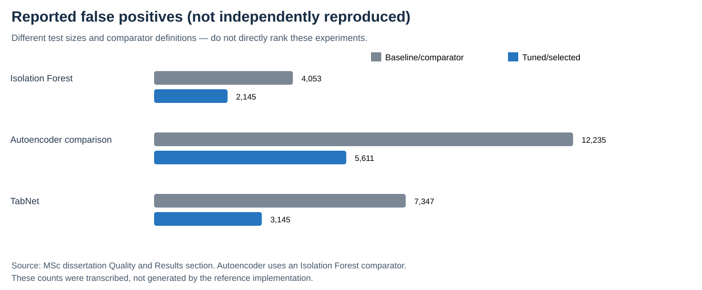

# Reducing False Positives in SOC Alerts Through Machine Learning

An MSc research portfolio project investigating whether machine-learning anomaly scoring and decision thresholds can reduce false-positive alerts in Security Operations Centre (SOC) workflows. The project examines **Isolation Forest**, **Autoencoder**, and **TabNet**.

**Researcher:** Fouzia Tamanna  
**Institution:** University of Hertfordshire  
**Programme:** MSc Computer Networks and Systems Security with Advanced Research

> **Evidence boundary:** The dissertation's reported results and this repository's newly organised *reference implementation* are distinct. Published comparisons below have not been reproduced with the original data. The project's original network-flow CSV is not available in the repository, and its claim of canonical UNSW-NB15 provenance remains **unverified**. See [dataset provenance](docs/dataset-provenance.md).

## Objectives

1. Investigate false-positive burden in IDS/SOC alerting.
2. Compare isolation-based, reconstruction-based and supervised tabular approaches.
3. Calibrate alert thresholds using validation data while retaining adequate attack recall.
4. Evaluate false positives *and* false negatives using a held-out test set.
5. Document computational, reproducibility and deployment limitations.

## Newly inspected benchmark test dataset

An additional CSV supplied on **2 November 2026** has **82,332 rows and 45 columns**, and its class distribution matches the standard **UNSW-NB15 predefined testing set** (37,000 normal, 45,332 attack). It is **not** the 211,043-row CSV in the original Colab exports. The official 175,341-row training file is still needed for a leakage-safe benchmark. The uploaded test data is **not** stored in this public repository; see [provenance and SHA-256](docs/dataset-provenance.md). Do **not** train on the test partition and then present results as held-out benchmark performance.

## Reported dissertation results

| Comparison | Test records | False positives before → after | Relative FP reduction | Attack recall before → after |
|---|---:|---:|---:|---:|
| Isolation Forest baseline vs Hyperopt-tuned | 42,209 | 4,053 → 2,145 | 47.08% | 99.89% → 99.89% |
| Isolation Forest comparator vs tuned Autoencoder | 63,313 | 12,235 → 5,611 | 54.14% | 39.89% → 97.52% |
| TabNet threshold 0.50 vs 0.94 | 42,209 | 7,347 → 3,145 | 57.19% | 99.65% → 86.74% |



**How to interpret:** These are not matched cross-model benchmark runs. The Autoencoder baseline is an *Isolation Forest comparator*, not an untuned Autoencoder. TabNet reduces false positives but also reduces attack recall; do not rank models purely on relative FP reduction. [Results and qualifications](docs/results.md).

## Architecture

```text
Verified labelled flow CSV (not supplied)
            |
            v
data.py: check binary labels, remove known identifiers,
         stratified split (train 60% / validation 20% / test 20%)
            |
            v
Train-fitted imputation, scaling, one-hot encoding
            |
            +------------------+-----------------+
            |                  |                 |
            v                  v                 v
Isolation Forest          Autoencoder          TabNet
(normal-only fit)         (normal-only fit)    (supervised fit)
            |                  |                 |
            +------------------+-----------------+
                               |
                               v
           validation scores -> threshold optimisation
                               |
                               v
           test scores -> confusion matrix, FPR,
           attack recall, precision, accuracy, ROC-AUC
                               |
                               v
                      artifacts/results.json
                               |
                               v
                    Optional figure generation
```

This 60/20/20 reference architecture does **not** reproduce the exact original dissertation experimental protocol.

## Repository structure

```text
src/soc_alerts/
  data.py             CSV validation, split, feature preprocessing
  models.py           Three optional model implementations
  metrics.py          Efficient validation-only ROC threshold selection
  cli.py              Experiment entry point
tests/                Unit and lightweight smoke tests
docs/                 Research methods, results, caveats, provenance, export audit
scripts/              Explicitly labelled reported/reference figures
data/raw/             Ignored local CSV inputs
artifacts/            Ignored local JSON/PNG outputs
.github/workflows/     CI for base dependencies and tests
```

Original Colab code/output exports are not published publicly until human sanitisation has been completed.

## Installation (Python 3.10+)

```bash
git clone https://github.com/ftamanna789/soc-alert-false-positive-reduction----.git
cd soc-alert-false-positive-reduction----
python3 -m venv .venv
source .venv/bin/activate
python -m pip install --upgrade pip
python -m pip install -e . pytest
python -m pytest -q
```

To run a smoke test without the missing original dataset, generate **synthetic educational data** (results are not research findings):

```bash
python scripts/make_synthetic_flows.py --output data/raw/synthetic_demo.csv
python -m soc_alerts.cli --csv data/raw/synthetic_demo.csv --model isolation_forest
```

The basic installation runs **Isolation Forest**. Install optional models separately:

```bash
python -m pip install -e ".[autoencoder]"
python -m pip install -e ".[tabnet]"
```

For figure generation, install `python -m pip install -r requirements-plot.txt`.

## Running an experiment

Provide a lawfully acquired, verified labelled network-flow CSV with a `label` target (**0 = normal, 1 = attack**) at `data/raw/network_flows.csv`. The code will reject missing or non-binary labels. The project does not supply the original CSV.

```bash
python -m soc_alerts.cli \
  --csv data/raw/network_flows.csv \
  --model isolation_forest \
  --min-recall 0.90 \
  --seed 42 \
  --output artifacts/results.json
```

Change `--model` to `autoencoder` or `tabnet` after installing its optional dependency. `--epochs 20` controls neural model training. Threshold selection is performed on the validation split only; test labels are reserved for final metrics.

## Sample output format

The following is a **schema illustration, not measured research output**:

```json
{
  "model": "isolation_forest",
  "study": "reference implementation (not original dissertation run)",
  "split": {"train": 60, "validation": 20, "test": 20},
  "feature_count": 5,
  "seed": 42,
  "selection": {
    "minimum_attack_recall": 0.9,
    "recall_constraint_met": true
  },
  "validation_metrics": {"threshold": 0.5, "tn": 8, "fp": 2, "fn": 1, "tp": 9},
  "test_metrics": {"threshold": 0.5, "tn": 8, "fp": 2, "fn": 1, "tp": 9}
}
```

Real output includes false-positive rate, attack recall, precision, accuracy and ROC-AUC; the figures above are *illustrative placeholders*.

## Reproducible figures

```bash
python scripts/plot_results.py --source reported
python scripts/plot_results.py --source reference --input artifacts/results.json
```

The first plot uses the **dissertation's reported FP counts** and visibly labels the image as not independently reproduced. The second uses an actual run's saved test metrics. Never present the first plot as model outputs recreated by the reference code.

## Tests and quality controls

Run `python -m pytest -q`. GitHub Actions runs the base-dependency tests on Python 3.10–3.12. The neural model branches depend on large optional libraries and are **not** currently covered by CI; neither has been validated against the missing original dataset.

## Important limitations

- **Dataset identity:** Uploaded code exports describe a 211,043-row, 44-column `train_test_network.csv`; this does not match canonical published UNSW-NB15 file schemas/sizes. Its real lineage cannot be confirmed without the CSV. [Investigation](docs/dataset-provenance.md).
- **No independent replication:** Three dissertation experiment tables are source-reported, not regenerated.
- **Comparability:** Model experiments and baselines differ; the Autoencoder comparison is against Isolation Forest.
- **Detection trade-off:** Reducing alert volume risks missed attacks; inspect attack recall and false negatives.
- **Operational realism:** No production SIEM integration, live SOC validation or measured deployment latency.
- **Audit scope:** Original code exports have only had a limited pattern-based sensitive-information scan; complete outputs have not passed manual review.
- **Reproducibility:** Reference code is a new controlled pipeline, not the exact archived Colab environment; dependencies are range-constrained, not fully locked.

Further reading: [Methodology](docs/methodology.md) · [Results](docs/results.md) · [Reproducibility](docs/reproducibility.md) · [Original export audit](docs/code-export-audit.md) · [Limitations](docs/limitations.md).

## Dataset reference

UNSW Canberra's [official UNSW-NB15 project page](https://research.unsw.edu.au/projects/unsw-nb15-dataset) documents the canonical source. That page is included **for verification**, not as proof that the supplied project CSV is that dataset.


## Presenting this research to employers

- [Research overview aligned to the MSc report](docs/research-overview.md)
- [CV project entries for SOC, cybersecurity and IT roles](docs/cv-project-entry.md)
- [Portfolio case study and LinkedIn text](docs/portfolio-project-entry.md)

The percentages are dissertation-reported comparisons, **not** independently replicated outputs of the current reference code. Read the dataset provenance and recall trade-offs before quoting them.

## Attribution

Original dissertation research and experiments by **Fouzia Tamanna**, University of Hertfordshire. Repository modules are a separately organised reference implementation. No software reuse licence has yet been selected; ask the repository owner before assuming reuse rights.
